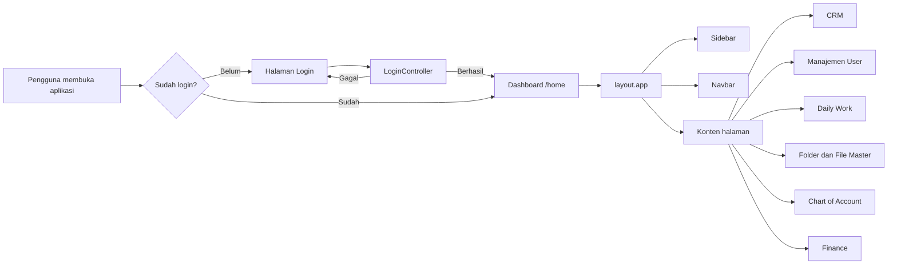
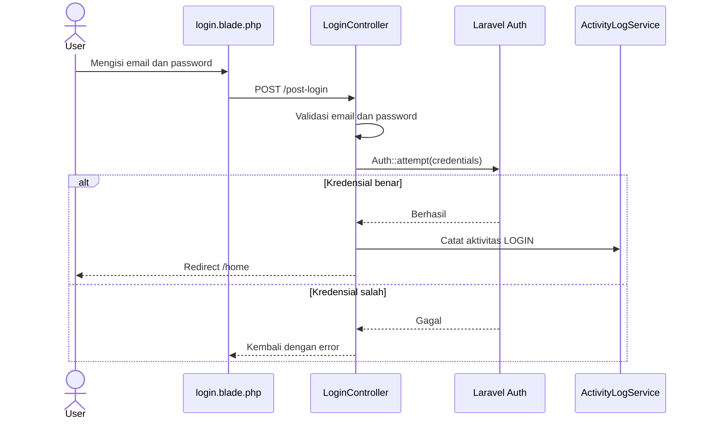
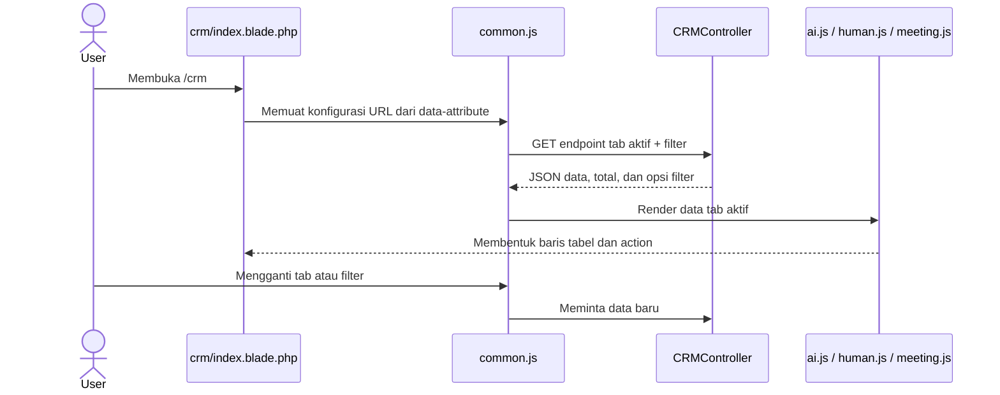
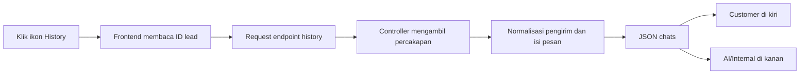
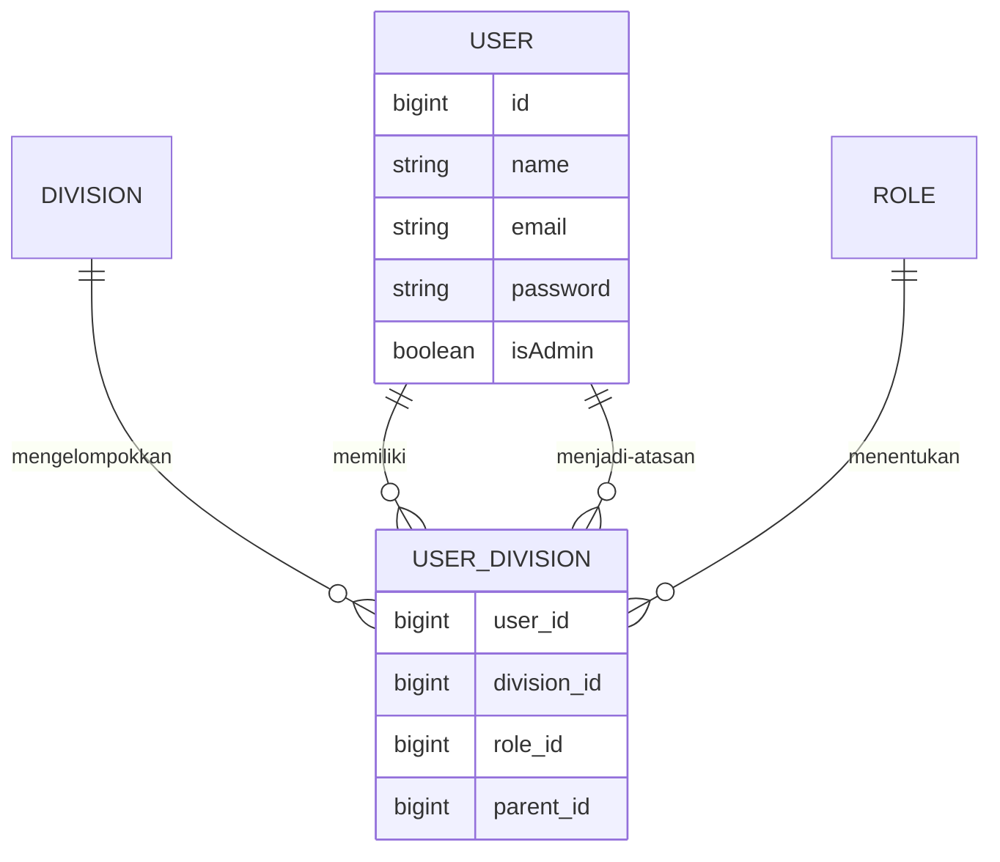
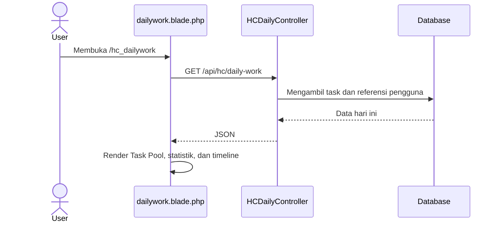
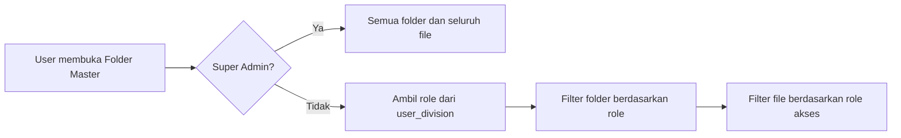
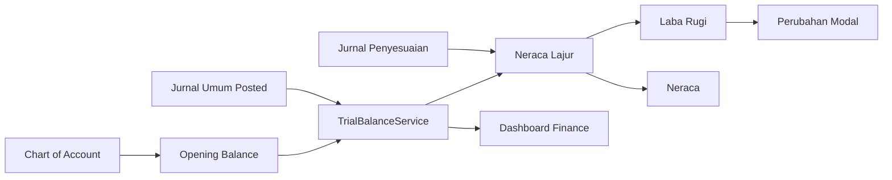

# ERP Lighter Media Group

Aplikasi internal berbasis Laravel untuk mengelola operasional Lighter Media Group. Dokumentasi ini untuk sementara membahas modul berikut:

- Login dan logout
- Layout utama aplikasi
- Sidebar
- Navbar
- Customer Relationship Management (CRM)
- Manajemen user
- Daily Work dan timeline kanban
- Folder Master
- File Master
- Chart of Account
- Finance: dashboard, pembayaran, profit, payroll, audit, dan laporan keuangan

> Modul lain yang terdapat di repository dapat ditambahkan ke dokumentasi ini secara bertahap.

## Daftar isi

- [Teknologi](#teknologi)
- [Menjalankan aplikasi](#menjalankan-aplikasi)
- [Gambaran alur aplikasi](#gambaran-alur-aplikasi)
- [Login dan logout](#login-dan-logout)
- [Layout utama aplikasi](#layout-utama-aplikasi)
- [Sidebar](#sidebar)
- [Navbar](#navbar)
- [CRM](#crm)
- [Manajemen User](#manajemen-user)
- [Daily Work](#daily-work)
- [Folder Master](#folder-master)
- [File Master](#file-master)
- [Chart of Account](#chart-of-account)
- [Modul Finance](#modul-finance)
- [Dashboard Finance](#dashboard-finance)
- [Pembayaran dan invoice](#pembayaran-dan-invoice)
- [Profit per client](#profit-per-client)
- [Payroll](#payroll)
- [Audit Trail](#audit-trail)
- [Laporan Keuangan](#laporan-keuangan)
- [Carry-forward saldo awal](#carry-forward-saldo-awal)
- [Pemeliharaan integritas client](#pemeliharaan-integritas-client)
- [Troubleshooting](#troubleshooting)
- [Pemeriksaan setelah perubahan](#pemeriksaan-setelah-perubahan)

## Teknologi

- PHP 8.2+
- Laravel 12
- PostgreSQL
- Blade
- Tailwind CSS 4
- Vite 7
- JavaScript

## Menjalankan aplikasi

### 1. Persyaratan

Pastikan komputer sudah memiliki:

- PHP 8.2 atau versi lebih baru
- Composer
- Node.js dan npm
- PostgreSQL

### 2. Instalasi

```bash
git clone <repository-url>
cd erp_lmg
composer install
npm install
```

Salin konfigurasi environment:

```bash
cp .env.example .env
php artisan key:generate
```

Pada Windows PowerShell, gunakan:

```powershell
Copy-Item .env.example .env
php artisan key:generate
```

### 3. Konfigurasi database

Sesuaikan bagian berikut di `.env`:

```dotenv
DB_CONNECTION=pgsql
DB_HOST=127.0.0.1
DB_PORT=5432
DB_DATABASE=erp_lmg_new
DB_USERNAME=root
DB_PASSWORD=
```

Buat database yang sesuai, lalu jalankan migration apabila database yang digunakan dibangun dari migration repository:

```bash
php artisan migrate
```

Beberapa bagian aplikasi menggunakan tabel operasional yang sudah ada. Pastikan skema database lingkungan pengembangan sesuai dengan database proyek.

### 4. Menjalankan development server

Cara praktis untuk menjalankan server Laravel, queue listener, dan Vite secara bersamaan:

```bash
composer run dev
```

Atau jalankan secara terpisah:

```bash
php artisan serve
npm run dev
```

Buka alamat yang ditampilkan Laravel, umumnya `http://127.0.0.1:8000`.

### 5. Build aset produksi

```bash
npm run build
```

## Struktur yang didokumentasikan

```text
app/
├── Http/Controllers/
│   ├── LoginController.php
│   ├── CRMController.php
│   ├── UserController.php
│   ├── HCDailyController.php
│   ├── MasterFolderController.php
│   ├── AccountMasterFileController.php
│   ├── COAController.php
│   ├── DashboardController.php
│   ├── InvoiceController.php
│   ├── LedgerController.php
│   └── PayrollController.php
├── Models/
│   ├── CRM.php
│   ├── CRM_HUMAN.php
│   ├── Meeting.php
│   ├── User.php
│   └── historyChat.php
└── Providers/MenuServiceProvider.php

public/js/crm/
├── common.js
├── ai.js
├── human.js
└── meeting.js

resources/views/
├── layout/app.blade.php
├── login.blade.php
├── crm/
│   ├── index.blade.php
│   ├── ai.blade.php
│   ├── human.blade.php
│   ├── meeting.blade.php
│   └── modals.blade.php
├── hc/dailywork.blade.php
├── master_folder/
│   ├── index.blade.php
│   ├── show.blade.php
│   └── preview.blade.php
├── account_master_file/
│   ├── index.blade.php
│   ├── show.blade.php
│   └── preview.blade.php
├── finance/
│   ├── coa.blade.php
│   ├── dashboard.blade.php
│   ├── invoice.blade.php
│   ├── profit_list.blade.php
│   ├── detail_profit.blade.php
│   ├── payroll.blade.php
│   ├── audit.blade.php
│   └── report_cash_flow.blade.php
├── partials/
│   ├── navbar.blade.php
│   └── sidebar_new.blade.php
└── users/index.blade.php

routes/
├── web.php
└── api.php
```

## Gambaran alur aplikasi



Semua halaman utama di dalam grup `auth` hanya dapat dibuka setelah pengguna berhasil login. Pengguna yang belum terautentikasi diarahkan ke halaman login.

## Login dan logout

### File utama

| Bagian | Lokasi |
|---|---|
| Route | `routes/web.php` |
| Controller | `app/Http/Controllers/LoginController.php` |
| Tampilan | `resources/views/login.blade.php` |
| Model pengguna | `app/Models/User.php` |

### Route

| Method | URL | Nama route | Fungsi |
|---|---|---|---|
| GET | `/` | `login` | Menampilkan form login |
| POST | `/post-login` | `post-login` | Memvalidasi dan memproses login |
| POST | `/logout` | `logout` | Mengakhiri sesi pengguna |

Route login menggunakan middleware `guest`, sedangkan logout berada di dalam middleware `auth`.

### Alur login



Proses logout mencatat aktivitas `LOGOUT`, menjalankan `Auth::logout()`, lalu mengarahkan pengguna kembali ke `/`.

### Mengubah tampilan login

Edit `resources/views/login.blade.php`. Pastikan form tetap:

- Menggunakan method `POST`
- Mengarah ke route `post-login`
- Menyertakan `@csrf`
- Menggunakan input bernama `email` dan `password`
- Menampilkan validation error dari Laravel

## Layout utama aplikasi

File `resources/views/layout/app.blade.php` menjadi kerangka semua halaman internal.

### Tanggung jawab layout

- Memuat Tailwind CSS dan JavaScript melalui Vite
- Menyediakan meta CSRF token
- Memuat style global aplikasi
- Menampilkan loading overlay
- Memasukkan `partials.sidebar_new`
- Memasukkan `partials.navbar`
- Menampilkan flash message `success` dan `error`
- Menampilkan konten halaman melalui `@yield('content')`
- Menyediakan modal logout dan elemen global lainnya

Struktur sederhananya:

```blade
@include('partials.sidebar_new')

<div id="content-wrapper">
    @include('partials.navbar')

    <main class="lmg-content">
        @yield('content')
    </main>
</div>
```

Halaman baru yang memakai layout utama dibuat seperti berikut:

```blade
@extends('layout.app')

@section('content')
    <h1>Judul Halaman</h1>
@endsection
```

Gunakan variabel `$title` dari controller agar judul browser menjadi `ERP | Judul Halaman`.

## Sidebar

Sidebar utama berada di `resources/views/partials/sidebar_new.blade.php`.

### Sumber data menu

`app/Providers/MenuServiceProvider.php` menjalankan view composer global dan membagikan data menu ke seluruh view, antara lain:

- Status super admin
- Divisi dan role pengguna aktif
- Client yang dapat diakses pengguna
- Produk Digital Marketing, Business Development, MCN, Tech, dan Commerce
- Daftar perusahaan Finance

Relasi pengguna dimuat dari `userDivisions` dan `userClients`. Karena data ini digunakan di banyak menu, perubahan struktur relasi harus diselaraskan dengan `MenuServiceProvider`.

### Hak tampil menu

Menu ditampilkan berdasarkan kombinasi:

- `Auth::user()->isAdmin`
- Divisi pengguna
- Role pengguna
- Client yang diberikan kepada pengguna
- Route yang sedang aktif

Manajemen User ditampilkan pada bagian Administration untuk super admin. CRM tersedia sebagai menu tersendiri pada sidebar.

### Dropdown dan animasi

Tombol dropdown menggunakan atribut:

```html
<button data-sidebar-collapse="collapseDivisi" aria-expanded="false">
    Divisi
</button>

<div id="collapseDivisi" class="hidden">
    <!-- submenu -->
</div>
```

JavaScript di bagian bawah `sidebar_new.blade.php`:

1. Mencari seluruh elemen `[data-sidebar-collapse]`.
2. Mencocokkan nilai atribut dengan `id` target.
3. Mengubah `aria-expanded`.
4. Menganimasikan `height`, `opacity`, dan `transform`.
5. Memutar chevron sesuai kondisi buka/tutup.

Jika menambahkan dropdown baru, pastikan nilai `data-sidebar-collapse` dan `id` target unik dan sama persis.

### Sidebar responsif

Tombol `#sidebarToggleTop` dapat membuka dan menutup sidebar pada desktop maupun perangkat kecil.

- Pada desktop, kondisi tertutup disimpan di `localStorage` dengan key `lmg-sidebar-collapsed` dan area konten otomatis menggunakan lebar penuh.
- Pada perangkat kecil, sidebar muncul sebagai panel di atas backdrop tanpa efek blur.
- Sidebar dapat ditutup melalui tombol close, backdrop, tombol Escape, atau setelah pengguna memilih link navigasi.
- `sidebar_new.blade.php` menjadi satu-satunya pengendali state sidebar. Jangan menambahkan script toggle kedua di navbar karena dapat membuat class `show` dan `translate-x-0` saling bertabrakan.
- Sidebar menggunakan `z-index` lebih tinggi daripada `#sidebarBackdrop` agar menu tidak tertutup lapisan gelap pada perangkat kecil.

## Navbar

Navbar berada di `resources/views/partials/navbar.blade.php` dan dimasukkan langsung oleh layout utama.

Navbar bertanggung jawab untuk:

- Tombol buka/tutup sidebar pada desktop dan perangkat mobile
- Identitas halaman/aplikasi
- Informasi pengguna aktif
- Akses menu akun
- Pemicu proses logout

Saat mengubah navbar, pertahankan ID yang digunakan JavaScript global, khususnya tombol pembuka sidebar dan elemen yang berkaitan dengan logout.

## CRM

### File utama

| Bagian | Lokasi |
|---|---|
| Route halaman | `routes/web.php` |
| Route API | `routes/api.php` |
| Controller | `app/Http/Controllers/CRMController.php` |
| Halaman utama | `resources/views/crm/index.blade.php` |
| Tabel AI | `resources/views/crm/ai.blade.php` |
| Tabel Human | `resources/views/crm/human.blade.php` |
| Tabel Meeting | `resources/views/crm/meeting.blade.php` |
| Modal | `resources/views/crm/modals.blade.php` |
| Koordinator frontend | `public/js/crm/common.js` |
| Renderer AI | `public/js/crm/ai.js` |
| Renderer Human | `public/js/crm/human.js` |
| Renderer Meeting | `public/js/crm/meeting.js` |

### Route halaman

`Route::resource('crm', CRMController::class)` menyediakan route resource CRM di dalam middleware `auth`. Halaman daftar utama dibuka melalui:

```text
GET /crm → CRMController@index → resources/views/crm/index.blade.php
```

### Endpoint API

| Method | Endpoint | Kegunaan |
|---|---|---|
| GET | `/api/crm/ai` | Mengambil daftar lead AI |
| GET | `/api/crm/human` | Mengambil daftar lead Human |
| GET | `/api/crm/meeting` | Mengambil jadwal meeting |
| POST | `/api/crm/{type}` | Membuat lead AI atau Human |
| PUT | `/api/crm/{type}/{id}` | Memperbarui lead |
| DELETE | `/api/crm/{type}/{id}` | Menghapus lead |
| GET | `/api/crm/history/{leadId}` | Mengambil history chat AI |
| GET | `/api/crm/human/history/{id}` | Mengambil history chat Human |
| GET | `/api/crm/human/history-media` | Mengambil media history Human |
| PATCH | `/api/crm/human/{id}/checklist` | Memperbarui checklist Human |
| PATCH | `/api/crm/human/{id}/follow-up` | Menambah follow-up harian |

Nilai `{type}` untuk operasi create, update, dan delete dibatasi pada `ai` atau `human`.

### Alur pemuatan data CRM



`common.js` menangani state tab, filter, request API, modal, create/edit/delete, dan error umum. File renderer hanya menangani tampilan serta interaksi khusus masing-masing tab.

### Struktur tampilan CRM

CRM memiliki tiga tab:

1. **AI** — lead yang berasal dari percakapan AI.
2. **Human** — lead yang ditangani tim internal, termasuk checklist dan follow-up.
3. **Jadwal Meeting** — jadwal meeting yang berelasi dengan CRM Human.

Data tabel diringkas menjadi kelompok informasi seperti aktivitas, identitas, kontak, kebutuhan, pipeline, progress, catatan, dan action agar tidak menghasilkan terlalu banyak kolom terpisah.

### Alur history chat



Untuk history AI, controller membaca pesan berdasarkan `session_id`. Pesan bertipe `human` dipetakan sebagai customer dan pesan bertipe `ai` dipetakan sebagai AI/internal. Payload tool atau system yang bukan pesan percakapan tidak ditampilkan.

### Modal CRM

Modal memakai kelas Tailwind `hidden`, bukan plugin modal Bootstrap. `window.CRMModal` di `common.js` menyediakan fungsi:

```javascript
window.CRMModal.open('crmTextDetailModal');
window.CRMModal.close('crmTextDetailModal');
```

Modal dapat ditutup melalui elemen `[data-modal-close]`, backdrop `[data-modal-backdrop]`, atau tombol Escape.

### Menambahkan field CRM

Saat menambahkan field baru, periksa semua lapisan berikut:

1. Kolom database dan model terkait.
2. Query, validasi, serta transformasi data di `CRMController`.
3. Input pada `crm/modals.blade.php` jika field dapat diedit.
4. Payload create/update di `common.js`.
5. Renderer `ai.js` atau `human.js`.
6. Header/struktur tabel Blade apabila membutuhkan kelompok tampilan baru.

## Manajemen User

### File utama

| Bagian | Lokasi |
|---|---|
| Route | `routes/web.php` |
| Controller | `app/Http/Controllers/UserController.php` |
| Tampilan | `resources/views/users/index.blade.php` |
| Model | `app/Models/User.php`, `Division.php`, `Role.php`, `userDivision.php` |

Route menggunakan resource controller:

```php
Route::resource('manajemen_user', UserController::class);
```

Route tersebut berada dalam middleware `auth`. Sidebar hanya menampilkan link Manajemen User kepada super admin. Jika pembatasan backend khusus admin diperlukan untuk seluruh route ini, tambahkan middleware admin pada route; menyembunyikan link di sidebar saja bukan pengamanan akses backend.

### Alur daftar user

```text
GET /manajemen_user
→ UserController@index
→ mengambil user non-super-admin beserta division, role, dan parent
→ mengambil seluruh division dan role
→ resources/views/users/index.blade.php
```

User utama dengan `isAdmin = true` tidak dimasukkan ke daftar yang dikelola.

### Membuat user

1. Sistem memastikan email belum digunakan.
2. Data user dibuat dengan `isAdmin = false`.
3. Password disimpan menggunakan `bcrypt`.
4. Relasi divisi, role, dan atasan dibuat di `user_division`.
5. Bawahan yang dipilih diarahkan ke user baru melalui `parent_id`.
6. Seluruh operasi dijalankan dalam database transaction.

### Memperbarui user

1. Sistem mencari user berdasarkan ID.
2. Email diperiksa agar tidak digunakan user lain.
3. Nama dan email diperbarui.
4. Password hanya diubah jika input password diisi.
5. Division, role, dan parent diperbarui.
6. Relasi bawahan lama dilepas dan relasi baru diterapkan.
7. Perubahan dibungkus dalam database transaction.

### Menghapus user

1. Seluruh bawahan yang menunjuk user tersebut dilepas dengan mengubah `parent_id` menjadi `null`.
2. Relasi user pada `user_division` dihapus.
3. Data user utama dihapus.
4. Seluruh proses dijalankan dalam transaction dan rollback jika terjadi error.

### Relasi hierarki



`parent_id` menunjuk user yang menjadi atasan. Role level `1` diperlakukan sebagai level tanpa parent ketika data user diperbarui.

## Daily Work

Daily Work adalah halaman penyusunan agenda kerja harian berbasis API. Blade hanya menjadi kerangka antarmuka; seluruh task, statistik, anggota tim, project, divisi, dan KPI dimuat sebagai JSON setelah halaman dibuka.

### File utama

| Bagian | Lokasi |
|---|---|
| Controller | `app/Http/Controllers/HCDailyController.php` |
| Tampilan | `resources/views/hc/dailywork.blade.php` |
| Route halaman | `routes/web.php` |
| Route data dan aksi | `routes/api.php` |
| Model task | `app/Models/Task.php` |

### Route

| Method | Endpoint | Fungsi |
|---|---|---|
| GET | `/hc_dailywork` | Menampilkan kerangka halaman Daily Work |
| GET | `/api/hc/daily-work` | Mengambil task, anggota, KPI, project, divisi, dan ringkasan |
| POST | `/api/hc/daily-work/tasks` | Menambahkan task |
| PUT | `/api/hc/daily-work/tasks/{task}` | Memperbarui task status `0` |
| DELETE | `/api/hc/daily-work/tasks/{task}` | Menghapus task status `0` |
| POST | `/api/hc/update-schedule` | Memasang atau mengubah jam task |
| POST | `/api/hc/update-status` | Menjalankan perubahan status task |
| POST | `/api/hc/cancel-remaining` | Memecah sisa durasi task ke Task Pool |

Route Daily Work di `api.php` menggunakan middleware `web` dan `auth`. Middleware `web` diperlukan karena autentikasi aplikasi menggunakan session browser. Tanpa middleware tersebut, `Auth::user()` pada controller akan bernilai `null`.

Pada operasi tambah dan edit, `start_time` atau jam mulai wajib diisi dengan format `HH:mm`. Validasi diterapkan pada form dan API.

### Alur pemuatan data



Identitas PIC di Daily Work ditampilkan menggunakan email, bukan nama user. API juga mengurutkan pilihan anggota berdasarkan email.

### Task Pool dan timeline

- Task tanpa `jam_mulai` ditampilkan pada Task Pool.
- Task dengan jadwal hari ini ditampilkan pada timeline pukul 08:00–17:00.
- Task selesai tampil ketika `tanggal_approve` adalah hari ini.
- Task split tampil ketika `tanggal_split` adalah hari ini.
- Task dari tanggal lain tidak dimasukkan ke agenda hari ini.
- Tinggi task mengikuti durasinya.
- Task yang waktunya bertabrakan ditempatkan pada lajur horizontal yang berbeda.
- Nama KPI dan note ditampilkan jika tersedia.

Task status `0` dapat diseret dari Task Pool ke timeline. Posisi jatuh dibulatkan ke interval 10 menit dan dikirim ke endpoint `update-schedule`. Task yang telah diproses tidak dapat diedit atau dihapus.

### Status task

| Status | Keterangan umum | Edit/hapus |
|---:|---|---|
| 0 | Belum dimulai | Diizinkan |
| 1 | Sedang dikerjakan | Tidak diizinkan |
| 2 | Perlu revisi | Tidak diizinkan |
| 3 | Menunggu persetujuan | Tidak diizinkan |
| 4 | Selesai | Tidak diizinkan |
| 5 | Dipecah | Tidak diizinkan |
| 7 | Terlambat | Tidak diizinkan |
| 8 | Waktu habis | Tidak diizinkan |
| 9 | Menunggu persetujuan overdue | Tidak diizinkan |

Aturan edit/hapus diperiksa pada frontend dan backend. Menyembunyikan tombol saja tidak dianggap sebagai pengamanan.

### Zoom timeline

Timeline mendukung zoom vertikal:

1. Arahkan kursor ke timeline.
2. Tahan tombol `Shift`.
3. Scroll ke atas untuk memperbesar skala waktu.
4. Scroll ke bawah untuk memperkecil skala waktu.
5. Klik persentase zoom untuk kembali ke ukuran normal.

Rentang skala adalah sekitar 7,5%–400%. Pada skala sangat kecil, task berubah menjadi bar ringkas. Detail KPI dan note tetap dapat diperiksa melalui tooltip atau modal detail. Perhitungan drag-and-drop menggunakan skala aktif agar jam yang disimpan tetap benar.

## Folder Master

Folder Master menyimpan dokumen bersama yang aksesnya ditentukan berdasarkan role dan divisi.

### File utama

| Bagian | Lokasi |
|---|---|
| Controller | `app/Http/Controllers/MasterFolderController.php` |
| Daftar folder | `resources/views/master_folder/index.blade.php` |
| Isi folder | `resources/views/master_folder/show.blade.php` |
| Preview PDF | `resources/views/master_folder/preview.blade.php` |
| Dokumen PDF | `resources/views/master_folder/document_pdf.blade.php` |

### Route utama

| Method | Endpoint | Fungsi |
|---|---|---|
| GET | `/master-folder` | Daftar folder yang dapat diakses |
| POST | `/master-folder` | Membuat folder |
| PUT | `/master-folder/{folder}` | Memperbarui folder dan role akses |
| DELETE | `/master-folder/{folder}` | Menghapus folder beserta file |
| GET | `/master-folder/{folder}` | Membuka isi folder |
| POST | `/master-folder/{folder}/files` | Mengunggah file |
| POST | `/master-folder/{folder}/documents` | Membuat dokumen PDF |
| PUT | `/master-folder/{folder}/files/{file}` | Memperbarui metadata atau dokumen |
| DELETE | `/master-folder/{folder}/files/{file}` | Menghapus file |

Admin dapat membuat, mengedit, dan menghapus folder. User biasa hanya melihat folder yang memiliki role sesuai salah satu assignment pada `user_division`. Jumlah file untuk user biasa juga menghitung file yang role aksesnya cocok.

Alur akses folder:



File disimpan pada disk Laravel `local` di direktori `master-folders/{folder_id}`. Menghapus folder turut menghapus direktori penyimpanannya.

## File Master

File Master adalah direktori dokumen per pengguna. Seorang user dapat melihat file miliknya dan file bawahan yang berada dalam jalur pelaporan. Perubahan isi hanya dapat dilakukan oleh pemilik akun.

### File utama

| Bagian | Lokasi |
|---|---|
| Controller | `app/Http/Controllers/AccountMasterFileController.php` |
| Daftar pengguna | `resources/views/account_master_file/index.blade.php` |
| Daftar file pengguna | `resources/views/account_master_file/show.blade.php` |
| Preview PDF | `resources/views/account_master_file/preview.blade.php` |
| Template PDF | `resources/views/account_master_file/document_pdf.blade.php` |

### Route utama

| Method | Endpoint | Fungsi |
|---|---|---|
| GET | `/file-master` | Menampilkan pemilik file yang dapat diakses |
| GET | `/file-master/{owner}` | Menampilkan file milik user |
| POST | `/file-master/{owner}/upload` | Mengunggah file milik sendiri |
| POST | `/file-master/{owner}/documents` | Membuat dokumen PDF |
| GET | `/file-master/{owner}/files/{fileName}/view` | Membuka halaman preview PDF |
| GET | `/file-master/{owner}/files/{fileName}/preview` | Mengirim stream PDF |
| GET | `/file-master/{owner}/files/{fileName}/download` | Mengunduh file |
| DELETE | `/file-master/{owner}/files/{file}` | Menghapus file milik sendiri |

File fisik disimpan di `account-master-files/{owner_id}` pada disk `local`. Nama file yang sama dibuat unik agar tidak menimpa file sebelumnya. File non-PDF dapat diunduh, sedangkan preview hanya tersedia untuk PDF.

## Chart of Account

Chart of Account mengelola akun keuangan, kategori, tipe debit/kredit, status aktif, dan saldo pembuka per perusahaan.

### File utama

| Bagian | Lokasi |
|---|---|
| Controller | `app/Http/Controllers/COAController.php` |
| Service | `app/Services/ChartOfAccountService.php` |
| Tampilan | `resources/views/finance/coa.blade.php` |
| Model | `app/Models/ChartOfAccount.php` |

Halaman mengambil data melalui endpoint `GET /finance_coa/data/akun/{id}`. Service melakukan filter berdasarkan perusahaan, tipe, status, kategori, dan kata pencarian.

### Route

| Method | Endpoint | Fungsi |
|---|---|---|
| GET | `/finance_coa/{id}` | Membuka COA perusahaan |
| GET | `/finance_coa/data/akun/{id}` | Mengambil daftar akun dalam JSON |
| POST | `/finance_coa/{id}` | Menambahkan akun |
| PUT | `/finance_coa/{id}` | Memperbarui akun |
| DELETE | `/finance_coa/{id}` | Menghapus akun |

### Paginasi

Paginasi dijalankan pada data hasil API di sisi frontend. Pengguna dapat memilih 10, 25, 50, atau 100 baris per halaman. Navigasi menyediakan nomor halaman, tombol Sebelumnya/Berikutnya, dan informasi rentang data. Perubahan filter atau pencarian mengembalikan tabel ke halaman pertama.

### Catatan JavaScript

Formatter HTML pada halaman ini bernama `escapeCoaHtml`. Gunakan nama tersebut dan jangan menggantinya menjadi `escapeHtml`, karena layout masih memuat beberapa skrip lama yang mempunyai fungsi global dengan nama `escapeHtml`. Benturan nama akan menyebabkan formatter angka memakai `.replace()` secara langsung dan menghasilkan error:

```text
TypeError: text.replace is not a function
```

## Modul Finance

Halaman Finance menggunakan `layout.app` dan komponen visual Tailwind dengan identitas Lighter Media Group. Menu Finance dikelompokkan berdasarkan perusahaan yang dapat diakses pengguna melalui data dari `MenuServiceProvider`.

### File utama

| Bagian | Controller/service | Tampilan |
|---|---|---|
| Dashboard | `DashboardController@finance_dashboard` | `finance/dashboard.blade.php` |
| Chart of Account | `COAController`, `ChartOfAccountService` | `finance/coa.blade.php` |
| Invoice dan pembayaran | `InvoiceController` | `finance/invoice.blade.php` |
| Profit client | `InvoiceController@list_client`, `detail` | `finance/profit_list.blade.php`, `detail_profit.blade.php` |
| Payroll | `PayrollController` | `finance/payroll.blade.php` |
| Audit Trail | `DashboardController@audit`, `getDataAudit` | `finance/audit.blade.php` |
| Buku Besar dan laporan | `LedgerController`, `LedgerService`, `TrialBalanceService` | `finance/bb/*`, `finance/report_cash_flow.blade.php` |
| Carry-forward | `CarryForwardOpeningBalances` | Perintah Artisan terjadwal |

Alur data umumnya:



Kolom `chart_of_account.type` berisi posisi normal akun (`D` atau `K`). Klasifikasi seperti `aset`, `pendapatan`, `beban`, `kewajiban`, dan `ekuitas` berada pada kolom `category`. Jangan memfilter kategori melalui kolom `type` karena hasilnya akan kosong.

## Dashboard Finance

Dashboard dibuka melalui `GET /dashboard_finance/{id}` dan menampilkan data perusahaan serta periode yang dipilih.

Ringkasan yang tersedia:

- Profit atau rugi bersih.
- Pendapatan dan beban.
- Arus kas masuk, keluar, dan bersih.
- Total posisi saldo aset.
- Komposisi pendapatan/beban dan kas masuk/keluar.
- Rincian akun aset dan akses menuju Jurnal Penutup.

Dashboard menggunakan `TrialBalanceService` sebagai sumber posisi akun. Perhitungan tersebut mencakup opening balance dan jurnal berstatus `posted`. Akun pendapatan dikenali melalui kategori `pendapatan` atau kode awal `4`, beban melalui kategori `beban` atau kode awal `5/6`, dan aset melalui kategori `aset` atau kode awal `1`.

## Pembayaran dan invoice

Halaman pembayaran dibuka melalui route `invoice.index`. Data tabel dimuat dari endpoint bernama `api.invoices.data` menggunakan `fetch`.

Halaman ini tidak menggunakan jQuery DataTables. Fitur pencarian dan pagination dijalankan oleh JavaScript halaman agar tidak bergantung pada plugin DataTables. Setiap invoice tetap menyediakan aksi:

- Mencatat pembayaran jika belum lunas.
- Membuka PDF invoice.
- Mengedit invoice.
- Menghapus invoice setelah konfirmasi.

API menyertakan `due_date` untuk tampilan dan `due_date_raw` berformat `YYYY-MM-DD` untuk input edit. Status `paid`, `partial`, dan belum lunas ditampilkan dengan badge berbeda.

## Profit per client

Profit per client memiliki dua mode:

- Mode ringkasan menampilkan kartu client, total invoice, pembayaran, sisa piutang, dan persentase pembayaran.
- Mode rincian menampilkan invoice dan pembayaran yang dikelompokkan berdasarkan client.

Klik kartu client untuk membuka halaman detail. Tampilan daftar dan detail memakai partial transaksi bersama `finance/partials/profit_transaction_table.blade.php` agar susunan invoice dan pembayaran tetap konsisten.

## Payroll

Payroll dibuka melalui `GET /payroll/{id}` dan datanya dimuat dari `/api/get-data-payroll` berdasarkan periode bulan.

Fungsi utama:

- Membuat tagihan gaji karyawan.
- Memfilter payroll berdasarkan periode.
- Menambahkan pembayaran gaji.
- Mengedit payroll sesuai status.
- Menghapus payroll beserta relasi jurnalnya jika periode belum dikunci.
- Menampilkan pagination dari respons API.

Form menggunakan akun beban untuk pencatatan payroll dan akun kewajiban/pembayaran ketika gaji dibayarkan. Tombol hapus harus menggunakan URL hasil `route('payroll.destroy', id)` tanpa operasi `.replace()` di dalam atribut HTML.

## Audit Trail

Audit Trail dibuka melalui route `audit.index`. Filter dan pagination mengambil data dari endpoint `api.audit.index` tanpa memuat ulang halaman.

Filter yang tersedia meliputi kata pencarian, modul, jenis aksi, tanggal awal, dan tanggal akhir. Jenis aksi utama adalah `CREATED`, `UPDATED`, dan `DELETED`.

Tombol detail pada setiap baris membuka modal yang menampilkan:

- Modul dan jenis aksi.
- Waktu serta pengguna.
- Deskripsi aktivitas.
- JSON data lama (`old_values`).
- JSON data baru (`new_values`).

Konten API harus dikonversi menjadi string dan di-escape sebelum dimasukkan ke HTML. Data JSON ditampilkan melalui `textContent` agar tidak dieksekusi sebagai markup.

## Laporan Keuangan

Halaman Laporan Keuangan berada di `finance/report_cash_flow.blade.php` dan mempunyai tab:

1. Arus Kas.
2. Laba Rugi.
3. Neraca.
4. Modal atau Laporan Perubahan Modal.

Laba Rugi dan Neraca menggunakan hasil Neraca Lajur yang sama agar angka halaman dan export tetap konsisten. Tab Modal khusus menggunakan akun berkode tepat `301`.

Rumus perubahan modal:

```text
Modal akhir periode sebelumnya
+ laba/rugi bersih periode sebelumnya yang tetap bertanda
= posisi modal periode laporan
```

Laba memiliki nilai positif dan menambah modal. Rugi memiliki nilai negatif dan mengurangi modal. Contoh:

```text
-39.125.810 + (-7.649.838) = -46.775.648
```

Untuk laporan September 2026, tab Modal menggunakan saldo akun `301` dan laba/rugi bersih Agustus 2026, bukan laba/rugi September. Nama periode sumber laba/rugi ditampilkan pada baris laporan agar tidak ambigu.

## Carry-forward saldo awal

Saldo awal bulanan diperbarui melalui:

```bash
php artisan finance:carry-forward-opening-balances --period=2026-09
```

Gunakan simulasi tanpa menyimpan perubahan:

```bash
php artisan finance:carry-forward-opening-balances --period=2026-09 --dry-run
```

Aturan carry-forward:

- Semua akun membawa saldo akhirnya dari bulan sebelumnya.
- Hanya akun berkode tepat `301` yang turut ditambah laba/rugi bersih bulan sebelumnya.
- Perhitungan laba/rugi mencakup akun kode awal `4`, `5`, dan `6`, termasuk jurnal penyesuaian.
- Perhitungan dilakukan terpisah untuk setiap perusahaan.
- Nilai rugi tidak diubah menjadi absolut; nilai negatif langsung ditambahkan sehingga mengurangi saldo modal.

Perintah ini dijadwalkan melalui `routes/console.php` pada tanggal 1 setiap bulan pukul 00:05 zona waktu Asia/Jakarta.

## Pemeliharaan integritas client

Migration berikut digunakan untuk membersihkan relasi client lama:

- `database/migrations/2026_09_14_000001_merge_duplicate_produk_client.php`
- `database/migrations/2026_09_14_000002_cleanup_orphan_client_relations.php`

Migration menggabungkan `produk_client` dengan nama yang sama, memindahkan referensi `client_division` dan `user_client` ke ID utama, lalu membersihkan relasi yang tidak lagi mempunyai pasangan pada `produk_client`. Selalu buat backup database sebelum menjalankan migration pembersihan pada lingkungan produksi.

## Troubleshooting

### Tailwind hilang setelah Vite memakai IP LAN

Jika `public/hot` tersedia, directive `@vite` selalu mengambil aset dari alamat dev server yang tertulis di file tersebut dan tidak memakai `public/build`. Contoh konfigurasi LAN:

```javascript
server: {
    host: '0.0.0.0',
    port: 5173,
    cors: { origin: 'http://192.168.14.99:8000' },
    hmr: { host: '192.168.14.99', port: 5173 },
}
```

Selaraskan juga `.env`:

```dotenv
APP_URL=http://192.168.14.99:8000
```

Untuk development, pastikan Vite tetap berjalan dan port `5173` dapat diakses:

```bash
npm run dev
```

Untuk memakai aset hasil build tanpa dev server, jalankan `npm run build`, pastikan `public/build/manifest.json` tersedia, lalu hapus file `public/hot`. Bersihkan cache dengan `php artisan optimize:clear` setelah mengubah URL atau konfigurasi aset.

### Tampilan tidak berubah setelah update

Bersihkan cache dan build ulang aset:

```bash
php artisan optimize:clear
php artisan view:cache
npm run build
```

Setelah itu lakukan hard refresh dengan `Ctrl+F5`.

### API Daily Work menganggap user belum login

Pastikan kelompok route Daily Work di `routes/api.php` menggunakan middleware berikut:

```php
Route::middleware(['web', 'auth'])->prefix('hc')->group(function () {
    // route Daily Work
});
```

Route API Laravel bersifat stateless secara default. Middleware `web` mengaktifkan session yang digunakan oleh autentikasi aplikasi ini.

### Daily Work tidak menampilkan task

Periksa hal berikut:

1. User memiliki assignment pada `user_division`.
2. `task.pic` menunjuk ID user yang benar.
3. Task terjadwal memiliki `tanggal_mulai` hari ini.
4. Task Pool memiliki `jam_mulai = null` dan belum berstatus selesai.
5. `task.project` masih memiliki pasangan di `produk_client`.
6. Request `/api/hc/daily-work` mengembalikan JSON, bukan redirect login atau halaman HTML.

### Task timeline bertumpuk

Pastikan API hanya mengirim task terjadwal untuk hari ini. Frontend membagi task yang waktunya benar-benar bersamaan ke lajur berbeda. Gunakan `Shift + scroll` untuk memperbesar timeline jika banyak task berdurasi pendek.

### Chart of Account menampilkan `text.replace is not a function`

Pastikan halaman COA memakai `escapeCoaHtml`, bukan fungsi global `escapeHtml`. Nilai kode akun dapat berupa angka dan harus dikonversi menggunakan `String(value)` sebelum `.replace()`.

### File tidak dapat dipreview

- Preview hanya tersedia untuk PDF.
- Pastikan file masih tersedia pada disk `local`.
- Jalankan `php artisan storage:link` hanya apabila bagian aplikasi yang digunakan memang membaca disk publik; file master saat ini dilayani melalui controller dari disk `local`.
- Periksa bahwa user memiliki akses ke pemilik File Master atau role Folder Master.

### Modal Folder/File Master tidak terbuka

Halaman detail yang masih memiliki interaksi editor lama menggunakan `resources/views/partials/lmg_legacy_workspace.blade.php` sebagai pengendali modal dan lapisan visual sementara. Pastikan partial tersebut tetap dimuat oleh halaman detail.

## Checklist pengujian per modul

### Daily Work

- Data awal dimuat melalui `/api/hc/daily-work`.
- Dropdown anggota menampilkan email.
- Task Pool dapat diseret ke timeline.
- Jam hasil drop sesuai interval yang dipilih.
- Zoom `Shift + scroll` mempertahankan titik waktu di bawah kursor.
- KPI dan note tampil jika tersedia.
- Edit/hapus hanya tersedia dan diterima API pada status `0`.
- Mulai, selesai, revisi, approval, dan kembali ke pool memperbarui tampilan.

### Folder Master dan File Master

- Filter divisi dan jabatan bekerja.
- Hak akses folder mengikuti role.
- Upload, download, preview PDF, edit, dan hapus bekerja.
- User tidak dapat mengubah File Master milik user lain.
- Penghapusan folder turut menghapus file fisiknya.

### Chart of Account

- Filter tipe, status, kategori, dan pencarian bekerja.
- Paginasi dan pilihan jumlah baris bekerja.
- Tambah, edit, dan hapus akun bekerja.
- Nilai numerik tidak memunculkan error formatter.
- Saldo pembuka tampil sesuai periode.

### Finance

- Dashboard menampilkan akun dari `category`, bukan mencoba membaca kategori dari `type`.
- Angka dashboard berubah ketika periode diganti.
- Dashboard hanya menghitung jurnal umum berstatus `posted`.
- Tabel Pembayaran dapat mencari dan berpindah halaman tanpa DataTables.
- Aksi bayar, PDF, edit, dan hapus invoice bekerja.
- Mode ringkasan dan rincian Profit menampilkan invoice serta pembayaran terkait.
- Filter periode, pembayaran, edit, hapus, dan pagination Payroll bekerja.
- Filter dan pagination Audit bekerja tanpa reload.
- Tombol detail Audit menampilkan `old_values` dan `new_values`.
- Tab Arus Kas, Laba Rugi, Neraca, dan Modal dapat berpindah dengan benar.
- Tab Modal memakai laba/rugi periode sebelumnya dan mempertahankan tanda negatif untuk rugi.
- Simulasi carry-forward akun `301` dapat dijalankan menggunakan opsi `--dry-run`.

### Sidebar dan navbar

- Tombol navbar membuka dan menutup sidebar pada desktop serta perangkat kecil.
- Konten melebar ketika sidebar desktop ditutup.
- Status sidebar desktop bertahan setelah halaman dimuat ulang.
- Sidebar perangkat kecil berada di atas backdrop dan seluruh menu terlihat jelas.
- Klik backdrop, tombol close, Escape, atau link menu menutup sidebar mobile.

## Pemeriksaan setelah perubahan

Jalankan pemeriksaan berikut sebelum membuat pull request:

```bash
php artisan view:cache
npm run build
php artisan test
```

Untuk memeriksa sintaks file JavaScript CRM secara langsung:

```bash
node --check public/js/crm/common.js
node --check public/js/crm/ai.js
node --check public/js/crm/human.js
node --check public/js/crm/meeting.js
```

Jika tampilan lama masih tersimpan setelah perubahan Blade atau JavaScript:

```bash
php artisan view:clear
php artisan cache:clear
```

Kemudian lakukan hard refresh pada browser.

## Catatan pengembangan

- Jangan menyimpan `.env`, password, token, atau service-account JSON ke Git.
- Semua form web yang mengubah data harus menyertakan CSRF token.
- Gunakan route bernama melalui helper `route()` pada Blade.
- Pertahankan ID dan `data-*` attribute yang digunakan JavaScript saat mengubah UI.
- Saat menambahkan menu, sinkronkan hak tampil sidebar dengan proteksi middleware backend.
- Perubahan struktur CRM harus diperiksa pada tab AI, Human, Meeting, modal, filter, dan history chat.
