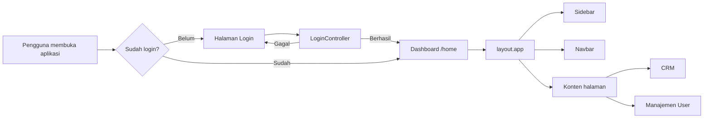
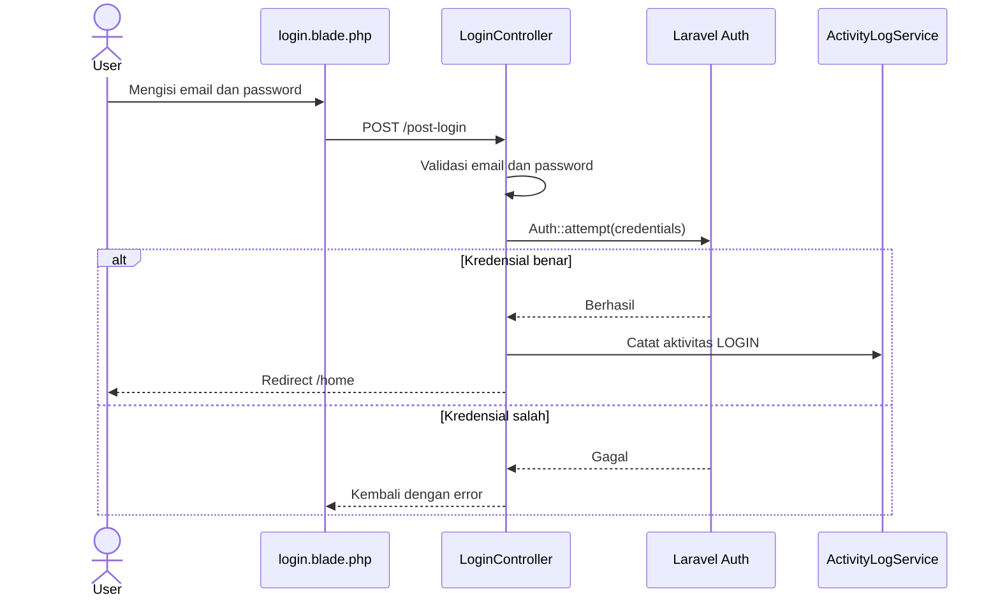
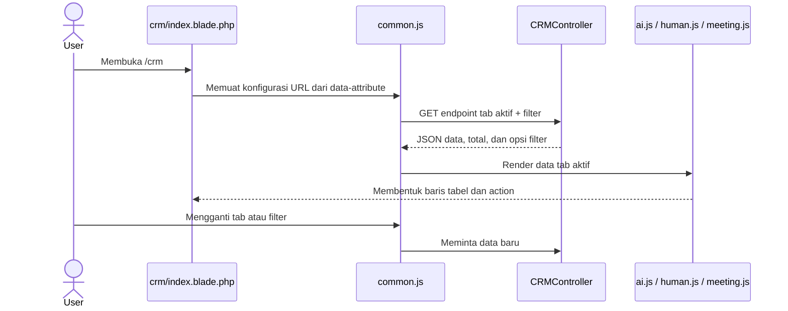
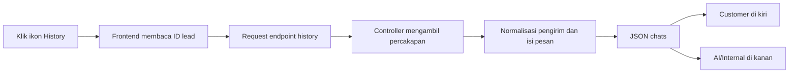
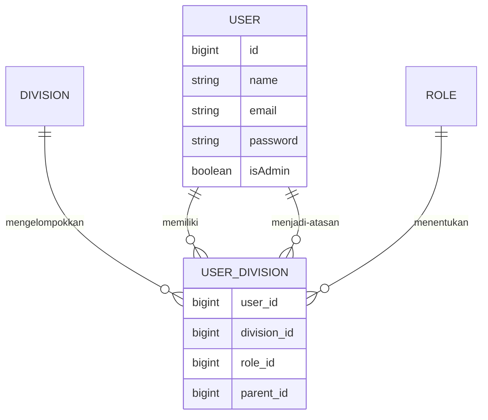

# ERP Lighter Media Group

Aplikasi internal berbasis Laravel untuk mengelola operasional Lighter Media Group. Dokumentasi ini untuk sementara membahas modul berikut:

- Login dan logout
- Layout utama aplikasi
- Sidebar
- Navbar
- Customer Relationship Management (CRM)
- Manajemen user

> Modul lain yang terdapat di repository belum dibahas dalam README ini dan dapat ditambahkan secara bertahap.

## Teknologi

- PHP 8.2+
- Laravel 12
- PostgreSQL
- Blade
- Tailwind CSS 4
- Vite 7
- JavaScript

## Menjalankan aplikasi

### 1. Persyaratan

Pastikan komputer sudah memiliki:

- PHP 8.2 atau versi lebih baru
- Composer
- Node.js dan npm
- PostgreSQL

### 2. Instalasi

```bash
git clone <repository-url>
cd erp_lmg
composer install
npm install
```

Salin konfigurasi environment:

```bash
cp .env.example .env
php artisan key:generate
```

Pada Windows PowerShell, gunakan:

```powershell
Copy-Item .env.example .env
php artisan key:generate
```

### 3. Konfigurasi database

Sesuaikan bagian berikut di `.env`:

```dotenv
DB_CONNECTION=pgsql
DB_HOST=127.0.0.1
DB_PORT=5432
DB_DATABASE=erp_lmg_new
DB_USERNAME=root
DB_PASSWORD=
```

Buat database yang sesuai, lalu jalankan migration apabila database yang digunakan dibangun dari migration repository:

```bash
php artisan migrate
```

Beberapa bagian aplikasi menggunakan tabel operasional yang sudah ada. Pastikan skema database lingkungan pengembangan sesuai dengan database proyek.

### 4. Menjalankan development server

Cara praktis untuk menjalankan server Laravel, queue listener, dan Vite secara bersamaan:

```bash
composer run dev
```

Atau jalankan secara terpisah:

```bash
php artisan serve
npm run dev
```

Buka alamat yang ditampilkan Laravel, umumnya `http://127.0.0.1:8000`.

### 5. Build aset produksi

```bash
npm run build
```

## Struktur yang didokumentasikan

```text
app/
├── Http/Controllers/
│   ├── LoginController.php
│   ├── CRMController.php
│   └── UserController.php
├── Models/
│   ├── CRM.php
│   ├── CRM_HUMAN.php
│   ├── Meeting.php
│   ├── User.php
│   └── historyChat.php
└── Providers/MenuServiceProvider.php

public/js/crm/
├── common.js
├── ai.js
├── human.js
└── meeting.js

resources/views/
├── layout/app.blade.php
├── login.blade.php
├── crm/
│   ├── index.blade.php
│   ├── ai.blade.php
│   ├── human.blade.php
│   ├── meeting.blade.php
│   └── modals.blade.php
├── partials/
│   ├── navbar.blade.php
│   └── sidebar_new.blade.php
└── users/index.blade.php

routes/
├── web.php
└── api.php
```

## Gambaran alur aplikasi



Semua halaman utama di dalam grup `auth` hanya dapat dibuka setelah pengguna berhasil login. Pengguna yang belum terautentikasi diarahkan ke halaman login.

## Login dan logout

### File utama

| Bagian | Lokasi |
|---|---|
| Route | `routes/web.php` |
| Controller | `app/Http/Controllers/LoginController.php` |
| Tampilan | `resources/views/login.blade.php` |
| Model pengguna | `app/Models/User.php` |

### Route

| Method | URL | Nama route | Fungsi |
|---|---|---|---|
| GET | `/` | `login` | Menampilkan form login |
| POST | `/post-login` | `post-login` | Memvalidasi dan memproses login |
| POST | `/logout` | `logout` | Mengakhiri sesi pengguna |

Route login menggunakan middleware `guest`, sedangkan logout berada di dalam middleware `auth`.

### Alur login



Proses logout mencatat aktivitas `LOGOUT`, menjalankan `Auth::logout()`, lalu mengarahkan pengguna kembali ke `/`.

### Mengubah tampilan login

Edit `resources/views/login.blade.php`. Pastikan form tetap:

- Menggunakan method `POST`
- Mengarah ke route `post-login`
- Menyertakan `@csrf`
- Menggunakan input bernama `email` dan `password`
- Menampilkan validation error dari Laravel

## Layout utama aplikasi

File `resources/views/layout/app.blade.php` menjadi kerangka semua halaman internal.

### Tanggung jawab layout

- Memuat Tailwind CSS dan JavaScript melalui Vite
- Menyediakan meta CSRF token
- Memuat style global aplikasi
- Menampilkan loading overlay
- Memasukkan `partials.sidebar_new`
- Memasukkan `partials.navbar`
- Menampilkan flash message `success` dan `error`
- Menampilkan konten halaman melalui `@yield('content')`
- Menyediakan modal logout dan elemen global lainnya

Struktur sederhananya:

```blade
@include('partials.sidebar_new')

<div id="content-wrapper">
    @include('partials.navbar')

    <main class="lmg-content">
        @yield('content')
    </main>
</div>
```

Halaman baru yang memakai layout utama dibuat seperti berikut:

```blade
@extends('layout.app')

@section('content')
    <h1>Judul Halaman</h1>
@endsection
```

Gunakan variabel `$title` dari controller agar judul browser menjadi `ERP | Judul Halaman`.

## Sidebar

Sidebar utama berada di `resources/views/partials/sidebar_new.blade.php`.

### Sumber data menu

`app/Providers/MenuServiceProvider.php` menjalankan view composer global dan membagikan data menu ke seluruh view, antara lain:

- Status super admin
- Divisi dan role pengguna aktif
- Client yang dapat diakses pengguna
- Produk Digital Marketing, Business Development, MCN, Tech, dan Commerce
- Daftar perusahaan Finance

Relasi pengguna dimuat dari `userDivisions` dan `userClients`. Karena data ini digunakan di banyak menu, perubahan struktur relasi harus diselaraskan dengan `MenuServiceProvider`.

### Hak tampil menu

Menu ditampilkan berdasarkan kombinasi:

- `Auth::user()->isAdmin`
- Divisi pengguna
- Role pengguna
- Client yang diberikan kepada pengguna
- Route yang sedang aktif

Manajemen User ditampilkan pada bagian Administration untuk super admin. CRM tersedia sebagai menu tersendiri pada sidebar.

### Dropdown dan animasi

Tombol dropdown menggunakan atribut:

```html
<button data-sidebar-collapse="collapseDivisi" aria-expanded="false">
    Divisi
</button>

<div id="collapseDivisi" class="hidden">
    <!-- submenu -->
</div>
```

JavaScript di bagian bawah `sidebar_new.blade.php`:

1. Mencari seluruh elemen `[data-sidebar-collapse]`.
2. Mencocokkan nilai atribut dengan `id` target.
3. Mengubah `aria-expanded`.
4. Menganimasikan `height`, `opacity`, dan `transform`.
5. Memutar chevron sesuai kondisi buka/tutup.

Jika menambahkan dropdown baru, pastikan nilai `data-sidebar-collapse` dan `id` target unik dan sama persis.

### Sidebar mobile

Pada layar kecil, sidebar dibuka dari tombol `#sidebarToggleTop`. Sidebar dapat ditutup melalui tombol close, backdrop, tombol Escape, atau setelah pengguna memilih link navigasi.

## Navbar

Navbar berada di `resources/views/partials/navbar.blade.php` dan dimasukkan langsung oleh layout utama.

Navbar bertanggung jawab untuk:

- Tombol pembuka sidebar pada perangkat mobile
- Identitas halaman/aplikasi
- Informasi pengguna aktif
- Akses menu akun
- Pemicu proses logout

Saat mengubah navbar, pertahankan ID yang digunakan JavaScript global, khususnya tombol pembuka sidebar dan elemen yang berkaitan dengan logout.

## CRM

### File utama

| Bagian | Lokasi |
|---|---|
| Route halaman | `routes/web.php` |
| Route API | `routes/api.php` |
| Controller | `app/Http/Controllers/CRMController.php` |
| Halaman utama | `resources/views/crm/index.blade.php` |
| Tabel AI | `resources/views/crm/ai.blade.php` |
| Tabel Human | `resources/views/crm/human.blade.php` |
| Tabel Meeting | `resources/views/crm/meeting.blade.php` |
| Modal | `resources/views/crm/modals.blade.php` |
| Koordinator frontend | `public/js/crm/common.js` |
| Renderer AI | `public/js/crm/ai.js` |
| Renderer Human | `public/js/crm/human.js` |
| Renderer Meeting | `public/js/crm/meeting.js` |

### Route halaman

`Route::resource('crm', CRMController::class)` menyediakan route resource CRM di dalam middleware `auth`. Halaman daftar utama dibuka melalui:

```text
GET /crm → CRMController@index → resources/views/crm/index.blade.php
```

### Endpoint API

| Method | Endpoint | Kegunaan |
|---|---|---|
| GET | `/api/crm/ai` | Mengambil daftar lead AI |
| GET | `/api/crm/human` | Mengambil daftar lead Human |
| GET | `/api/crm/meeting` | Mengambil jadwal meeting |
| POST | `/api/crm/{type}` | Membuat lead AI atau Human |
| PUT | `/api/crm/{type}/{id}` | Memperbarui lead |
| DELETE | `/api/crm/{type}/{id}` | Menghapus lead |
| GET | `/api/crm/history/{leadId}` | Mengambil history chat AI |
| GET | `/api/crm/human/history/{id}` | Mengambil history chat Human |
| GET | `/api/crm/human/history-media` | Mengambil media history Human |
| PATCH | `/api/crm/human/{id}/checklist` | Memperbarui checklist Human |
| PATCH | `/api/crm/human/{id}/follow-up` | Menambah follow-up harian |

Nilai `{type}` untuk operasi create, update, dan delete dibatasi pada `ai` atau `human`.

### Alur pemuatan data CRM



`common.js` menangani state tab, filter, request API, modal, create/edit/delete, dan error umum. File renderer hanya menangani tampilan serta interaksi khusus masing-masing tab.

### Struktur tampilan CRM

CRM memiliki tiga tab:

1. **AI** — lead yang berasal dari percakapan AI.
2. **Human** — lead yang ditangani tim internal, termasuk checklist dan follow-up.
3. **Jadwal Meeting** — jadwal meeting yang berelasi dengan CRM Human.

Data tabel diringkas menjadi kelompok informasi seperti aktivitas, identitas, kontak, kebutuhan, pipeline, progress, catatan, dan action agar tidak menghasilkan terlalu banyak kolom terpisah.

### Alur history chat



Untuk history AI, controller membaca pesan berdasarkan `session_id`. Pesan bertipe `human` dipetakan sebagai customer dan pesan bertipe `ai` dipetakan sebagai AI/internal. Payload tool atau system yang bukan pesan percakapan tidak ditampilkan.

### Modal CRM

Modal memakai kelas Tailwind `hidden`, bukan plugin modal Bootstrap. `window.CRMModal` di `common.js` menyediakan fungsi:

```javascript
window.CRMModal.open('crmTextDetailModal');
window.CRMModal.close('crmTextDetailModal');
```

Modal dapat ditutup melalui elemen `[data-modal-close]`, backdrop `[data-modal-backdrop]`, atau tombol Escape.

### Menambahkan field CRM

Saat menambahkan field baru, periksa semua lapisan berikut:

1. Kolom database dan model terkait.
2. Query, validasi, serta transformasi data di `CRMController`.
3. Input pada `crm/modals.blade.php` jika field dapat diedit.
4. Payload create/update di `common.js`.
5. Renderer `ai.js` atau `human.js`.
6. Header/struktur tabel Blade apabila membutuhkan kelompok tampilan baru.

## Manajemen User

### File utama

| Bagian | Lokasi |
|---|---|
| Route | `routes/web.php` |
| Controller | `app/Http/Controllers/UserController.php` |
| Tampilan | `resources/views/users/index.blade.php` |
| Model | `app/Models/User.php`, `Division.php`, `Role.php`, `userDivision.php` |

Route menggunakan resource controller:

```php
Route::resource('manajemen_user', UserController::class);
```

Route tersebut berada dalam middleware `auth`. Sidebar hanya menampilkan link Manajemen User kepada super admin. Jika pembatasan backend khusus admin diperlukan untuk seluruh route ini, tambahkan middleware admin pada route; menyembunyikan link di sidebar saja bukan pengamanan akses backend.

### Alur daftar user

```text
GET /manajemen_user
→ UserController@index
→ mengambil user non-super-admin beserta division, role, dan parent
→ mengambil seluruh division dan role
→ resources/views/users/index.blade.php
```

User utama dengan `isAdmin = true` tidak dimasukkan ke daftar yang dikelola.

### Membuat user

1. Sistem memastikan email belum digunakan.
2. Data user dibuat dengan `isAdmin = false`.
3. Password disimpan menggunakan `bcrypt`.
4. Relasi divisi, role, dan atasan dibuat di `user_division`.
5. Bawahan yang dipilih diarahkan ke user baru melalui `parent_id`.
6. Seluruh operasi dijalankan dalam database transaction.

### Memperbarui user

1. Sistem mencari user berdasarkan ID.
2. Email diperiksa agar tidak digunakan user lain.
3. Nama dan email diperbarui.
4. Password hanya diubah jika input password diisi.
5. Division, role, dan parent diperbarui.
6. Relasi bawahan lama dilepas dan relasi baru diterapkan.
7. Perubahan dibungkus dalam database transaction.

### Menghapus user

1. Seluruh bawahan yang menunjuk user tersebut dilepas dengan mengubah `parent_id` menjadi `null`.
2. Relasi user pada `user_division` dihapus.
3. Data user utama dihapus.
4. Seluruh proses dijalankan dalam transaction dan rollback jika terjadi error.

### Relasi hierarki



`parent_id` menunjuk user yang menjadi atasan. Role level `1` diperlakukan sebagai level tanpa parent ketika data user diperbarui.

## Pemeriksaan setelah perubahan

Jalankan pemeriksaan berikut sebelum membuat pull request:

```bash
php artisan view:cache
npm run build
php artisan test
```

Untuk memeriksa sintaks file JavaScript CRM secara langsung:

```bash
node --check public/js/crm/common.js
node --check public/js/crm/ai.js
node --check public/js/crm/human.js
node --check public/js/crm/meeting.js
```

Jika tampilan lama masih tersimpan setelah perubahan Blade atau JavaScript:

```bash
php artisan view:clear
php artisan cache:clear
```

Kemudian lakukan hard refresh pada browser.

## Catatan pengembangan

- Jangan menyimpan `.env`, password, token, atau service-account JSON ke Git.
- Semua form web yang mengubah data harus menyertakan CSRF token.
- Gunakan route bernama melalui helper `route()` pada Blade.
- Pertahankan ID dan `data-*` attribute yang digunakan JavaScript saat mengubah UI.
- Saat menambahkan menu, sinkronkan hak tampil sidebar dengan proteksi middleware backend.
- Perubahan struktur CRM harus diperiksa pada tab AI, Human, Meeting, modal, filter, dan history chat.
