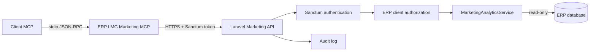

# ERP LMG Marketing MCP

MCP privat dan read-only untuk mengakses analitik marketing ERP LMG melalui Laravel API. Setiap permintaan menggunakan identitas pengguna yang terautentikasi dan hanya dapat membaca client yang memang diberikan kepada pengguna tersebut.

## Fitur utama

- Personal access token Laravel Sanctum dengan ability `marketing:read`.
- Authorization client mengikuti assignment Digital Marketing di ERP.
- Seluruh endpoint analitik menggunakan `GET` dan bersifat read-only.
- Periode maksimum 366 hari dan pagination maksimum 100 baris.
- Allowlist platform, source, dan metrik; tidak menerima ekspresi SQL bebas.
- Query melalui Laravel Query Builder dan parameter binding.
- Audit log hanya menyimpan nama tool, client, dan filter aman.
- Metadata respons mencakup periode, freshness, sumber, dan kelengkapan.
- Deduplikasi platform mirror pada operasi agregasi.
- Tidak membaca atau mengembalikan password, token OAuth, atau credential platform.

## Arsitektur



Proses MCP tidak mempunyai koneksi database langsung. Validasi, authentication, authorization, dan pembentukan respons dilakukan oleh Laravel API.

## Persyaratan dan konfigurasi

- ERP LMG dapat diakses melalui HTTP atau HTTPS.
- Node.js 18 atau lebih baru.
- Personal Sanctum token dengan ability `marketing:read`.
- Pengguna ERP tidak terkunci dan mempunyai assignment client yang sesuai.

| Environment variable | Wajib | Keterangan |
|---|---:|---|
| `ERP_LMG_API_URL` | Ya | Base URL ERP, misalnya `https://erp.example.com` |
| `ERP_LMG_SANCTUM_TOKEN` | Ya | Personal Sanctum token pengguna |

Setiap pengguna membuat token miliknya sendiri melalui menu **Profil → Hubungkan Codex** di ERP. Token hanya ditampilkan satu kali, memiliki ability `marketing:read`, berlaku 90 hari, dan dapat dicabut kembali dari halaman yang sama. Jangan berbagi token antar-pengguna.

PowerShell:

```powershell
$env:ERP_LMG_API_URL = 'http://127.0.0.1:8000'
$env:ERP_LMG_SANCTUM_TOKEN = '<personal-sanctum-token>'
node .\plugins\erp-lmg-marketing\server\index.mjs
```

Linux/macOS:

```bash
export ERP_LMG_API_URL='http://127.0.0.1:8000'
export ERP_LMG_SANCTUM_TOKEN='<personal-sanctum-token>'
node ./plugins/erp-lmg-marketing/server/index.mjs
```

Jangan menyimpan token di repository, file contoh, log, atau dokumentasi publik. Konfigurasi MCP tersedia di [`mcp.json`](mcp.json), sedangkan metadata plugin tersedia di [`plugin.json`](plugin.json).

## Instalasi personal di Codex Desktop

Repository menyediakan marketplace lokal di direktori `plugins`. Tambahkan marketplace tanpa mengubah marketplace lain:

```powershell
codex plugin marketplace add <repo-root>\plugins
codex plugin add erp-lmg-marketing@erp-lmg-local
```

Setelah instalasi:

1. Pastikan `ERP_LMG_API_URL` dan `ERP_LMG_SANCTUM_TOKEN` tersedia pada environment yang menjalankan Codex Desktop.
2. Tutup dan buka kembali Codex Desktop agar environment dan plugin dimuat ulang.
3. Jalankan `codex plugin list --json` dan pastikan `erp-lmg-marketing@erp-lmg-local` berstatus installed serta enabled.
4. Mulai chat baru dan tanyakan: “Client marketing apa saja yang boleh saya akses?”

Untuk memperbarui source lokal, edit package di repository lalu restart/reload Codex. Jika Codex menggunakan cache versi, hapus dan pasang kembali melalui CLI; jangan mengedit cache plugin secara langsung.

Untuk mencabut akses:

```powershell
codex plugin remove erp-lmg-marketing@erp-lmg-local
```

Setelah itu cabut personal Sanctum token melalui proses administrasi ERP. Menghapus plugin saja tidak otomatis mencabut token.

## Tool yang tersedia

### `marketing_list_clients`

Menampilkan client marketing yang boleh diakses pengguna. Mendukung `search`, `status`, `page`, dan `per_page` (maksimum 100).

### `marketing_get_data_availability`

Menampilkan ketersediaan content plan dan performance snapshot. Parameter wajib: `client_id`. Filter opsional: `start_date`, `end_date`, `platform`, `page`, dan `per_page`.

### `marketing_get_performance_summary`

Menampilkan snapshot terbaru dan perubahan dari snapshot pertama. Parameter wajib: `client_id`. Filter opsional: `start_date`, `end_date`, `platform`, `source`, `page`, dan `per_page`.

### `marketing_get_content_plan`

Menampilkan content plan canonical; salinan target platform mirror dikeluarkan.

| Parameter | Tipe | Wajib | Ketentuan |
|---|---|---:|---|
| `client_id` | integer | Ya | Client terotorisasi |
| `start_date` | date | Ya | `YYYY-MM-DD` |
| `end_date` | date | Ya | `YYYY-MM-DD`, inklusif |
| `platform` | string | Tidak | Platform allowlist |
| `source` | string | Tidak | `organic` atau `paid` |
| `status` | integer | Tidak | ID status content plan |
| `pic_id` | integer | Tidak | ID PIC |
| `page` | integer | Tidak | Minimum `1` |
| `per_page` | integer | Tidak | Maksimum `100` |

Output dapat memuat tanggal, waktu, platform, source, tipe konten, strategi, pilar, hook, body, CTA, status, dan identitas PIC yang aman.

### `marketing_get_content_mix`

Mengagregasi content plan berdasarkan source, platform, tipe konten, strategi, pilar, hook, CTA, dan status. Parameter wajib: `client_id`, `start_date`, dan `end_date`. Filter opsional: `platform` dan `source`.

### `marketing_get_performance_trend`

Menampilkan titik tren dari snapshot tersimpan tanpa interpolasi atau pengisian nol untuk tanggal yang hilang.

| Parameter | Tipe | Wajib | Ketentuan |
|---|---|---:|---|
| `client_id` | integer | Ya | Client terotorisasi |
| `start_date` | date | Ya | `YYYY-MM-DD` |
| `end_date` | date | Ya | `YYYY-MM-DD` |
| `platform` | string | Tidak | Filter platform |
| `source` | string | Tidak | `organic` atau `paid` |
| `granularity` | string | Tidak | `daily`, `weekly`, atau `monthly` |
| `metrics` | string[] | Tidak | Maksimum 14 metrik allowlist |

Output mencakup rentang data aktual, titik per bucket, perubahan absolut/persentase, arah tren, waktu snapshot terakhir, dan bucket yang hilang. Persentase bernilai `null` jika nilai awal nol.

### `marketing_get_top_content`

Meranking item snapshot dengan nilai terbaru berdasarkan satu metrik.

| Parameter | Tipe | Wajib | Ketentuan |
|---|---|---:|---|
| `client_id` | integer | Ya | Client terotorisasi |
| `start_date` | date | Ya | `YYYY-MM-DD` |
| `end_date` | date | Ya | `YYYY-MM-DD` |
| `metric` | string | Ya | Metrik ranking allowlist |
| `platform` | string | Tidak | Filter platform |
| `source` | string | Tidak | `organic` atau `paid` |
| `direction` | string | Tidak | `best` atau `worst` |
| `limit` | integer | Tidak | Maksimum `50` |

Identitas eksternal mentah tidak dikembalikan. API menghasilkan `content_key` berupa hash dan mencoba mencocokkan judul, tanggal, serta platform dengan content plan canonical.

### `marketing_get_paid_performance`

Merangkum paid snapshot yang tersimpan tanpa memanggil Meta Ads atau platform eksternal.

| Parameter | Tipe | Wajib | Ketentuan |
|---|---|---:|---|
| `client_id` | integer | Ya | Client terotorisasi |
| `start_date` | date | Ya | `YYYY-MM-DD` |
| `end_date` | date | Ya | `YYYY-MM-DD` |
| `platform` | string | Tidak | Filter platform |
| `campaign_id` | string | Tidak | Digunakan jika tersimpan |
| `metric` | string | Tidak | Metrik pengurutan allowlist |
| `page` | integer | Tidak | Minimum `1` |
| `per_page` | integer | Tidak | Maksimum `100` |

CTR, CPC, CPM, CPL, CPA, dan ROAS hanya dihitung jika seluruh komponen tersedia dan pembagi tidak nol. Spend tidak digabungkan jika currency hilang atau berbeda. Engagement tidak dianggap conversion.

## Platform dan metrik

Platform:

```text
facebook, instagram, tiktok, threads, google, youtube
```

Metrik tren:

```text
posts, reach, impressions, engagement, likes, comments, shares,
clicks, spend, views, followers, followers_gained, saves, reactions
```

Metrik ranking konten:

```text
reach, impressions, engagement, likes, comments, shares, clicks, spend
```

Metrik paid untuk pengurutan:

```text
spend, impressions, reach, clicks, engagement, leads, conversions
```

`leads`, `conversions`, dan `revenue` hanya digunakan jika tersimpan eksplisit. Tool tidak menyimpulkannya dari engagement atau penjualan umum.

## Format respons

```json
{
  "client_id": 123,
  "data": [],
  "pagination": null,
  "meta": {
    "period": {
      "start_date": "2026-10-01",
      "end_date": "2026-10-14",
      "max_days": 366,
      "timezone": "Asia/Jakarta"
    },
    "source": "analysis_snapshots",
    "freshness": {
      "latest_captured_at": "2026-10-14 12:00:00"
    },
    "completeness": {
      "status": "complete"
    }
  }
}
```

`pagination` berupa objek pada respons yang dipaginasi. Status kelengkapan dapat berupa `complete`, `partial`, `insufficient_data`, atau `no_data`.

## Authentication dan authorization

Semua endpoint memakai middleware:

```text
auth:sanctum
RequireMarketingMcpToken
throttle:60,1
```

Token harus berupa personal access token dengan ability `marketing:read`, dimiliki pengguna aktif, dan pengguna tidak boleh terkunci. API tidak mempercayai `client_id` dari request: akses diperiksa melalui assignment Digital Marketing, `client_division`, role, dan `user_client` ERP. Akses yang tidak sah menghasilkan HTTP `403`.

## Endpoint Laravel

| Method | Endpoint | Tool |
|---|---|---|
| GET | `/api/marketing-mcp/clients` | `marketing_list_clients` |
| GET | `/api/marketing-mcp/clients/{client}/data-availability` | `marketing_get_data_availability` |
| GET | `/api/marketing-mcp/clients/{client}/performance-summary` | `marketing_get_performance_summary` |
| GET | `/api/marketing-mcp/clients/{client}/content-plan` | `marketing_get_content_plan` |
| GET | `/api/marketing-mcp/clients/{client}/content-mix` | `marketing_get_content_mix` |
| GET | `/api/marketing-mcp/clients/{client}/performance-trend` | `marketing_get_performance_trend` |
| GET | `/api/marketing-mcp/clients/{client}/top-content` | `marketing_get_top_content` |
| GET | `/api/marketing-mcp/clients/{client}/paid-performance` | `marketing_get_paid_performance` |

Contoh request API:

```bash
curl --get 'https://erp.example.com/api/marketing-mcp/clients/123/performance-trend' \
  --header 'Accept: application/json' \
  --header 'Authorization: Bearer <personal-sanctum-token>' \
  --data-urlencode 'start_date=2026-10-01' \
  --data-urlencode 'end_date=2026-10-14' \
  --data-urlencode 'granularity=daily' \
  --data-urlencode 'metrics[]=reach'
```

## Error API

| HTTP | Arti |
|---:|---|
| `401` | Token tidak ada atau tidak valid |
| `403` | Ability salah, pengguna terkunci, atau client tidak boleh diakses |
| `404` | Route atau resource tidak ditemukan |
| `422` | Parameter tidak valid atau periode melebihi batas |
| `429` | Batas request terlampaui |

MCP meneruskan pesan error API sebagai hasil tool `isError: true` tanpa memasukkan bearer token ke respons.

## Troubleshooting startup

| Gejala | Pemeriksaan |
|---|---|
| Plugin tidak muncul | Jalankan `codex plugin marketplace list --json`, lalu restart Codex Desktop |
| Server gagal startup | Pastikan `node --version` tersedia dan `server/index.mjs` ada di package |
| Token belum dikonfigurasi | Atur `ERP_LMG_SANCTUM_TOKEN` pada environment Codex, bukan di package |
| HTTP `401` | Token tidak valid atau sudah dicabut |
| HTTP `403` | Ability bukan `marketing:read`, akun terkunci, atau client tidak diizinkan |
| HTTP `422` | Periksa tanggal, platform, source, metric, limit, atau pagination |
| Connection refused/timeout | Pastikan ERP aktif dan `ERP_LMG_API_URL` dapat dijangkau dari komputer ini |
| Tool belum terlihat setelah update | Restart Codex Desktop dan periksa kembali status plugin |

## Batasan data

- Tool hanya membaca snapshot, content plan, dan tabel referensi yang tersedia.
- Tidak ada API platform sosial yang dipanggil saat tool berjalan.
- Snapshot yang hilang tidak diinterpolasi dan tidak dianggap nol.
- Capture lama dapat menormalisasi metrik item yang hilang menjadi nol; histori tidak selalu dapat membedakan nol asli dari field yang dahulu tidak tersedia.
- Snapshot paid standar umumnya tidak mempertahankan currency, campaign ID, leads, conversions, atau revenue. Rasio terkait akan ditandai tidak tersedia.
- Snapshot dapat merepresentasikan nilai kumulatif atau periode filter saat capture, sehingga snapshot berulang tidak dijumlahkan.
- Jika paid snapshot tidak memiliki item teridentifikasi, agregat lintas platform tidak dijumlahkan karena berisiko double counting.
- Deduplikasi bergantung pada identitas item dan pencatatan `platform_mirror_copies` yang konsisten.

## Audit dan keamanan

Pemanggilan tool yang berhasil dicatat sebagai aktivitas `READ` pada modul `marketing_mcp`. Audit context hanya memuat nama tool, ID client, filter allowlist, serta pagination/limit. Bearer token, token OAuth, password, credential, email pengguna, metrics mentah, dan isi konten tidak disimpan di audit context tool.

Gunakan HTTPS di luar localhost, token per pengguna, ability minimum `marketing:read`, serta secret manager untuk konfigurasi runtime. Jangan menonaktifkan throttle atau client authorization.

## Pengujian

```bash
php artisan test tests/Feature/MarketingAnalyticsApiTest.php
node --check plugins/erp-lmg-marketing/server/index.mjs
php artisan route:list --path=api/marketing-mcp --method=GET
```

Contract test mencakup authentication, authorization antar-client, validasi, pagination, data kosong, JSON rusak, gap snapshot, ranking, perhitungan paid, currency, attribution, platform mirror, audit log aman, dan verifikasi read-only.

## Struktur file

```text
plugins/erp-lmg-marketing/
├── plugin.json
├── mcp.json
├── README.md
└── server/
    └── index.mjs

app/
├── Http/Controllers/Api/MarketingAnalyticsController.php
├── Http/Middleware/RequireMarketingMcpToken.php
└── Services/MarketingAnalyticsService.php

routes/api.php
tests/Feature/MarketingAnalyticsApiTest.php
```

## Ruang lingkup

Plugin ini privat untuk analitik internal ERP LMG. Source ini belum melakukan packaging atau publikasi plugin. Deployment, credential, perubahan database, mekanisme login utama, dan integrasi API platform berada di luar ruang lingkup MCP read-only.
